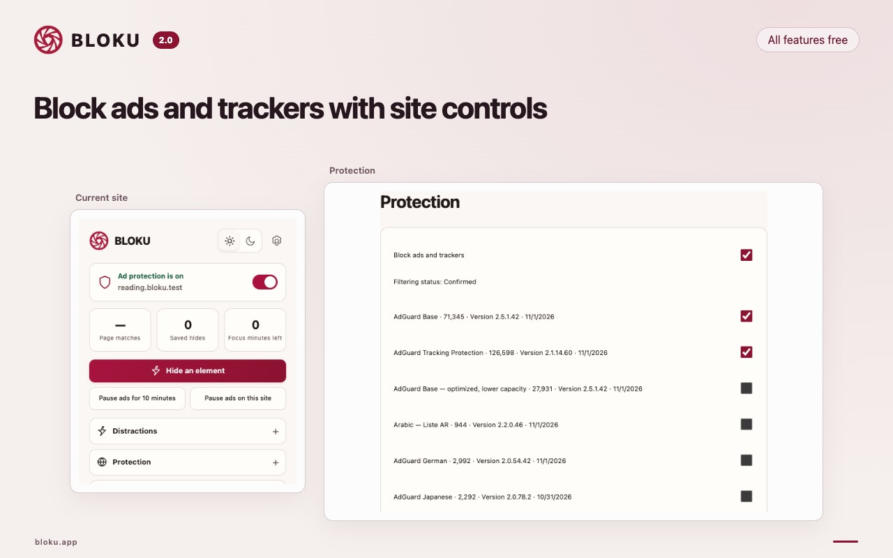

# BLOKU

**A quieter browser. More room to focus.**

Free, open-source ad blocking and distraction control for Chrome desktop 145+. All features are free. No account, subscription or paid feature tier.

[Install from the Chrome Web Store](https://chromewebstore.google.com/detail/mjfieeobdnanclichjahkhkkhlipnigj) · [Visit bloku.app](https://bloku.app) · [Get help](https://bloku.app/support)



## What it does

- Block many ads and trackers with packaged filters, including optional regional and annoyance lists.
- Pause ad blocking for a site, hide individual elements and restore saved hides.
- Hide selected feeds, short videos and other page distractions with site presets.
- Set focus sessions, weekly schedules and daily site allowances.
- Choose supported cookie-rejection flows, clicked-link cleanup and local privacy controls.
- Use English, Arabic, Spanish, Brazilian Portuguese, French, German, Japanese or Hindi, with light and dark themes.

Filtering coverage varies by site and Chrome rule capacity. Focus controls are user-controlled. Settings and activity are processed locally; the extension has no telemetry. See the [privacy policy](extension/PRIVACY.md).

## Build from source

Use **Node.js 22.12+** and npm. Run these commands from the repository root; each project has its own pinned lockfile.

**Extension**

```sh
npm ci --prefix extension
npm run build --prefix extension
npm run check --prefix extension
```

In Chrome, open `chrome://extensions`, enable **Developer mode**, choose **Load unpacked**, and select `extension/dist`.

**Website**

```sh
npm ci --prefix website
npm run check --prefix website
npm run preview --prefix website
```

Open [localhost:4173](http://localhost:4173). The website builds localized static pages with React and Vite.

## Repository

| Directory | Contents |
| --- | --- |
| [`extension/`](extension/) | Chrome extension, filtering engine, tests and pinned filter sources |
| [`website/`](website/) | Marketing website, translations and public assets |
| [`shared/`](shared/) | Product metadata shared with the website |
| [`docs/`](docs/) | Architecture and filter maintenance |

See the [extension guide](extension/README.md), [website guide](website/README.md), [contribution guide](CONTRIBUTING.md), [security policy](SECURITY.md) and [changelog](CHANGELOG.md).

## Open source

Made by [Frameless](https://frameless.com.eg). BLOKU software is licensed under [GPL-3.0-only](LICENSE). The BLOKU name and artwork remain Frameless brand assets.

Built with [AdGuard filtering libraries](https://github.com/AdguardTeam/tsurlfilter), pinned [AdGuard FiltersRegistry sources](https://github.com/AdguardTeam/FiltersRegistry) and [DuckDuckGo Autoconsent](https://github.com/duckduckgo/autoconsent). Upstream components retain their licenses; see [third-party notices](extension/NOTICE.md). Optional support through the website never unlocks features.

Support: [support@bloku.app](mailto:support@bloku.app)
